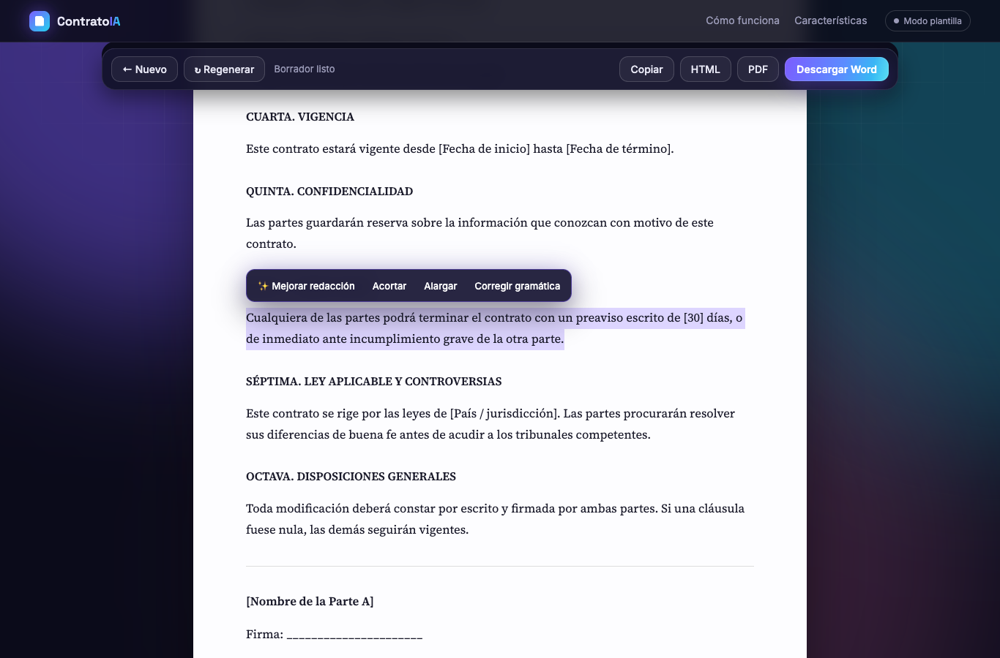

# Generador de contratos con IA

[](https://github.com/Angel252000/contract-generator/actions/workflows/ci.yml)

Describe el contrato que necesitas, obtén un borrador completo redactado por IA (Claude), edítalo en el
navegador y descárgalo en Word, HTML o PDF. Incluye versión web y de consola.

**Demo:** https://contract-generator-ten-tau.vercel.app (modo plantilla, sin IA)

> Los borradores son orientativos y no constituyen asesoría legal.




## Funciones

- **Caja tipo chat** con sugerencias de un clic (servicios, NDA, mantenimiento, carta de autorización, pago,
  contratista independiente) que rellenan la descripción y el tipo de contrato.
- **Subir documento** (.docx, .txt, .md) para usarlo como base o fuente de datos del borrador.
- **6 tipos de contrato:** prestación de servicios, acuerdo de pago, NDA, mantenimiento, contratista
  independiente y personalizado, más campos opcionales (partes, monto, vigencia, jurisdicción).
- **Generación en streaming:** el contrato aparece mientras se redacta.
- **Edición con IA sobre la selección:** mejorar redacción, acortar, alargar, corregir gramática.
- **Edición manual** directa en la hoja; el borrador se guarda en el navegador.
- **Exportación:** Word (.docx real), HTML, PDF (imprimir) y copiar.
- **Modo plantilla sin API key:** la app funciona offline con una plantilla fija, útil para probar.
- **CLI:** mismo flujo en la terminal, con edición por número de cláusula.

## Inicio rápido

Requiere Python 3.11+ y [uv](https://docs.astral.sh/uv/) (o `pip`).

```bash
git clone https://github.com/Angel252000/contract-generator.git
cd contract-generator
uv venv && uv pip install -e ".[dev]"
cp .env.example .env          # y agrega tu ANTHROPIC_API_KEY (opcional)

.venv/bin/contract-generator-web   # web → http://127.0.0.1:5050
.venv/bin/contract-generator       # consola
```

| Variable | Por defecto | Uso |
|---|---|---|
| `ANTHROPIC_API_KEY` | — | Activa la redacción con IA. Sin ella, modo plantilla. |
| `CONTRACT_MODEL` | `claude-opus-5-5` | Modelo de Claude. |
| `HOST` / `PORT` | `127.0.0.1` / `5050` | Dirección del servidor web. |
| `FLASK_DEBUG` | — | `1` usa el servidor de desarrollo de Flask en vez de waitress. |

## Arquitectura

```
src/contract_generator/
├── domain/     entidades y validación (tipos de contrato, solicitudes, acciones de edición)
├── data/       redactores detrás de la interfaz ContractWriter: Claude y plantilla offline
├── service/    casos de uso (generar, editar) y exportación a .docx
├── api/        web (Flask + SSE, servida con waitress) y CLI
├── templates/  interfaz HTML
└── static/     CSS y JS del editor
```

Las dependencias van hacia adentro: `api → service → data → domain`. El redactor se elige al arrancar
(`create_service`): Claude si hay credenciales, plantilla si no.

### API HTTP

| Método | Ruta | Cuerpo | Respuesta |
|---|---|---|---|
| `POST` | `/api/generate` | `{description, type, details, reference}` | `text/event-stream` con `{text}`, `{done}` o `{error}` |
| `POST` | `/api/extract` | multipart `file` (.docx/.txt/.md) | `{name, text, chars}` |
| `POST` | `/api/edit` | `{text, action, context}` | `{text}` |
| `POST` | `/api/export/docx` | `{html, title}` | archivo `.docx` |
| `GET` | `/healthz` | — | `{status, version, writer}` |

Errores de validación → `400`; fallos de la API de Claude → `502`; cuerpo > 5 MB → `413`.

## Despliegue en Vercel

Vercel detecta Flask solo: `api/index.py` expone `app` y las dependencias salen de `pyproject.toml`.
No hace falta `vercel.json` (una regla `rewrites` hacia `/api/index` rompe las rutas: Flask recibe la ruta
reescrita y devuelve 404).

```bash
vercel deploy --prod --project contract-generator
vercel env add ANTHROPIC_API_KEY production   # activa la IA en producción
```

> Con la API key puesta, cualquiera con el enlace gasta créditos de tu cuenta de Anthropic.

## Desarrollo

```bash
pytest --cov=contract_generator   # pruebas (sin red: Claude se simula)
ruff check . && ruff format .     # lint y formato
```

CI corre lint y pruebas en Python 3.11–3.13 en cada push y PR.

## Licencia

MIT
